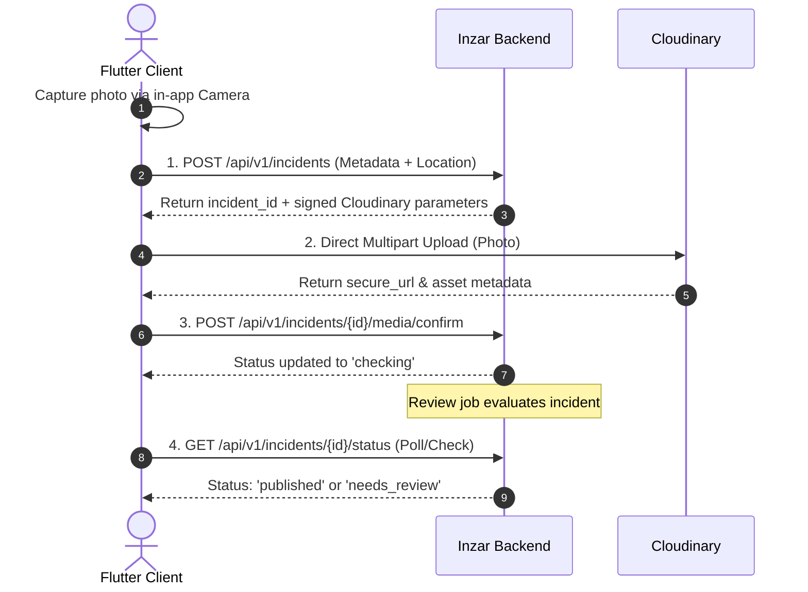

# Inzar Backend: Flutter Integration & Frontend Implementation Guide

This guide is the complete technical reference for Flutter frontend developers building the **Inzar** mobile application (iOS & Android).

---

## 1. API Architecture & Envelope Structure

### 1.1 Base URL & Environment
- **Development**: `http://10.0.2.2:8000/api/v1` (Android Emulator) or `http://127.0.0.1:8000/api/v1` (iOS Simulator)
- **Production**: `https://<your-render-domain>.onrender.com/api/v1`

### 1.2 Universal Response Envelope
Every `/api/v1/*` endpoint returns a standardized response envelope.

#### Success Response Shape (`status: true`)
```json
{
  "status": true,
  "success": true,
  "status_code": 200,
  "data": { ... } // Or list: [ ... ]
}
```

#### Error Response Shape (`status: false`)
```json
{
  "status": false,
  "success": false,
  "status_code": 400,
  "message": "Description of what went wrong",
  "error": {
    "code": "machine_readable_code",
    "message": "Description of what went wrong",
    "details": {}
  },
  "data": null
}
```

---

## 2. Dart Envelope & Error Models

Use this model in your network layer to parse all API responses:

```dart
class ApiResponse<T> {
  final bool status;
  final bool success;
  final int statusCode;
  final String? message;
  final T? data;
  final ApiError? error;

  ApiResponse({
    required this.status,
    required this.success,
    required this.statusCode,
    this.message,
    this.data,
    this.error,
  });

  factory ApiResponse.fromJson(
    Map<String, dynamic> json,
    T Function(dynamic json)? fromJsonT,
  ) {
    return ApiResponse<T>(
      status: json['status'] ?? false,
      success: json['success'] ?? false,
      statusCode: json['status_code'] ?? 500,
      message: json['message'],
      data: json['data'] != null && fromJsonT != null ? fromJsonT(json['data']) : null,
      error: json['error'] != null ? ApiError.fromJson(json['error']) : null,
    );
  }
}

class ApiError {
  final String code;
  final String message;
  final Map<String, dynamic> details;

  ApiError({
    required this.code,
    required this.message,
    this.details = const {},
  });

  factory ApiError.fromJson(Map<String, dynamic> json) {
    return ApiError(
      code: json['code'] ?? 'unknown_error',
      message: json['message'] ?? 'An error occurred',
      details: json['details'] is Map<String, dynamic> ? json['details'] : {},
    );
  }
}
```

---

## 3. Network Client with Dio & Automatic Token Refresh

Inzar uses **short-lived JWT access tokens** (15 mins) and **rotating refresh tokens** (30 days) with **reuse detection** (reusing a rotated token revokes all sessions).

```dart
import 'package:dio/dio.dart';
import 'package:flutter_secure_storage/flutter_secure_storage.dart';

class ApiClient {
  final Dio dio = Dio(
    BaseOptions(
      baseUrl: 'http://10.0.2.2:8000/api/v1',
      connectTimeout: const Duration(seconds: 10),
      receiveTimeout: const Duration(seconds: 10),
      headers: {'Content-Type': 'application/json', 'Accept': 'application/json'},
    ),
  );

  final FlutterSecureStorage storage = const FlutterSecureStorage();

  ApiClient() {
    dio.interceptors.add(
      InterceptorsWrapper(
        onRequest: (options, handler) async {
          final accessToken = await storage.read(key: 'access_token');
          if (accessToken != null) {
            options.headers['Authorization'] = 'Bearer $accessToken';
          }
          return handler.next(options);
        },
        onError: (DioException error, handler) async {
          // Automatic Refresh on 401 Unauthorized
          if (error.response?.statusCode == 401 && error.requestOptions.path != '/auth/refresh') {
            final refreshed = await _refreshToken();
            if (refreshed) {
              final newAccessToken = await storage.read(key: 'access_token');
              error.requestOptions.headers['Authorization'] = 'Bearer $newAccessToken';
              final retryResponse = await dio.fetch(error.requestOptions);
              return handler.resolve(retryResponse);
            }
          }
          return handler.next(error);
        },
      ),
    );
  }

  Future<bool> _refreshToken() async {
    final refreshToken = await storage.read(key: 'refresh_token');
    if (refreshToken == null) return false;

    try {
      final response = await Dio().post(
        '${dio.options.baseUrl}/auth/refresh',
        data: {'refresh_token': refreshToken},
      );

      if (response.statusCode == 200 && response.data['data'] != null) {
        final data = response.data['data'];
        await storage.write(key: 'access_token', value: data['access_token']);
        await storage.write(key: 'refresh_token', value: data['refresh_token']);
        return true;
      }
    } catch (_) {
      // Re-use detected or token expired: log user out
      await storage.deleteAll();
    }
    return false;
  }
}
```

---

## 4. Authentication Flows

### 4.1 Signup (`POST /auth/signup`)
- **Body**:
  ```json
  {
    "email": "user@example.com",
    "password": "StrongPassword!2026",
    "display_name": "Jane Doe"
  }
  ```
- **Response `data`**:
  ```json
  {
    "user": {
      "id": "uuid",
      "email": "user@example.com",
      "display_name": "Jane Doe",
      "role": "user",
      "email_verified": false,
      "created_at": "2026-10-30T10:00:00Z"
    },
    "tokens": {
      "access_token": "...",
      "refresh_token": "...",
      "token_type": "bearer"
    }
  }
  ```

### 4.2 Login (`POST /auth/login`)
- **Body**: `{ "email": "...", "password": "..." }`
- **Response `data`**: Same structure as signup.
- Users must verify their email before login; unverified accounts receive `403 email_not_verified`.

### 4.3 Google Sign-In (`POST /auth/google`)
Use `google_sign_in` package to obtain the Google ID Token:
```dart
final GoogleSignInAccount? account = await GoogleSignIn().signIn();
final GoogleSignInAuthentication auth = await account!.authentication;
final idToken = auth.idToken;

final response = await apiClient.dio.post('/auth/google', data: {'id_token': idToken});
```

### 4.4 Email Verification (`POST /auth/verify-email`)
- **Body**: `{ "token": "..." }`

---

## 5. Startup & Configuration

When the app boots, fetch:
1. `GET /config`: Map limits and allowed preset radius options.
2. `GET /categories`: Active incident categories with colors and icons.

### 5.1 App Config (`GET /config`)
```json
{
  "status": true,
  "data": {
    "max_search_radius_km": 50,
    "allowed_radius_options_km": [1, 3, 5, 10, 25, 50],
    "max_description_length": 1000,
    "fuzz_distance_m": 200
  }
}
```

### 5.2 Categories (`GET /categories`)
Only active categories are returned, ordered by display `sort_order`:
```json
{
  "status": true,
  "data": [
    {
      "id": "d13e3872-...",
      "slug": "fire",
      "name": "Fire",
      "icon_key": "flame",
      "color_hex": "#EF4444",
      "sort_order": 1,
      "urgency": "high",
      "safety_note": "Keep a safe distance and do not obstruct emergency responders."
    },
    {
      "id": "a42b1093-...",
      "slug": "accident",
      "name": "Traffic Accident",
      "icon_key": "car-crash",
      "color_hex": "#F97316",
      "sort_order": 2,
      "urgency": "routine",
      "safety_note": "Do not stop on active highways. Watch for oncoming traffic."
    }
  ]
}
```

---

## 6. Live Map Integration

### 6.1 Querying Incidents by Radius
When user is browsing around their current location:
- `GET /incidents?lat=37.7749&lon=-122.4194&radius_km=5&category_id=<optional_uuid>`

#### Response Item Shape:
```json
{
  "status": true,
  "data": [
    {
      "id": "incident-uuid",
      "category_id": "category-uuid",
      "title": "Flooding on Main St",
      "latitude": 37.7758,
      "longitude": -122.4182,
      "place_label": "Financial District",
      "urgency": "high",
      "age_minutes": 24,
      "distance_m": 350.5,
      "verification_label": "community_corroborated",
      "media_thumbnail_url": "https://res.cloudinary.com/.../photo.jpg"
    }
  ]
}
```

### 6.2 Querying Incidents by Viewport Bounding Box
When user drags or zooms the Google Map:
- `GET /incidents?min_lat=...&min_lon=...&max_lat=...&max_lon=...`

### 6.3 Clustered Low-Zoom Mode
When zoom level < 11:
- `GET /incidents?lat=...&lon=...&radius_km=25&clustered=true`
```json
{
  "status": true,
  "data": [
    {
      "cluster_id": "37.75_-122.4",
      "latitude": 37.75,
      "longitude": -122.4,
      "count": 14
    }
  ]
}
```

---

## 7. Incident Reporting Flow (Step-by-Step)

The reporting process follows a strict 4-step pipeline:



### Step 1: Capture Photo in Flutter
Per product rules, **gallery uploads are disabled**. Only capture photos via device camera:
```dart
final ImagePicker picker = ImagePicker();
final XFile? photo = await picker.pickImage(
  source: ImageSource.camera,
  maxWidth: 1920,
  maxHeight: 1080,
  imageQuality: 85,
);
```

### Step 2: Create Incident (`POST /incidents`)
- **Endpoint**: `POST /api/v1/incidents`
- **Request Body**:
  ```json
  {
    "category_id": "d13e3872-...",
    "title": "Large structure fire visible near port",
    "description": "Thick black smoke and two fire engines arriving.",
    "latitude": 37.7812,
    "longitude": -122.4019,
    "place_label": "Pier 39"
  }
  ```
- **Response**:
  ```json
  {
    "status": true,
    "data": {
      "incident_id": "7a3f81e2-...",
      "review_status": "awaiting_media",
      "upload_params": {
        "upload_url": "https://api.cloudinary.com/v1_1/inzar/image/upload",
        "api_key": "123456789012345",
        "timestamp": 1730001234,
        "folder": "inzar/incidents/7a3f81e2-...",
        "public_id": "photo_a9b1c2d3e4f5",
        "signature": "3b4f...a89c"
      }
    }
  }
  ```

### Step 3: Direct Upload from Flutter to Cloudinary
Upload the image directly to Cloudinary using standard multipart:
```dart
Future<Map<String, dynamic>> uploadToCloudinary({
  required XFile photoFile,
  required Map<String, dynamic> uploadParams,
}) async {
  final formData = FormData.fromMap({
    'file': await MultipartFile.fromFile(photoFile.path, filename: 'photo.jpg'),
    'api_key': uploadParams['api_key'],
    'timestamp': uploadParams['timestamp'],
    'folder': uploadParams['folder'],
    'public_id': uploadParams['public_id'],
    'signature': uploadParams['signature'],
  });

  final cdnResponse = await Dio().post(
    uploadParams['upload_url'],
    data: formData,
  );

  return cdnResponse.data; // contains secure_url, width, height, bytes, format
}
```

### Step 4: Confirm Upload (`POST /incidents/{id}/media/confirm`)
Once Cloudinary responds with 200 OK:
- **Endpoint**: `POST /api/v1/incidents/{incident_id}/media/confirm`
- **Body**:
  ```json
  {
    "cloudinary_public_id": "inzar/incidents/7a3f81e2-.../photo_a9b1c2d3e4f5",
    "secure_url": "https://res.cloudinary.com/.../photo_a9b1c2d3e4f5.jpg",
    "width": 1920,
    "height": 1080,
    "bytes": 624102,
    "format": "jpg"
  }
  ```
- **Response**:
  ```json
  {
    "status": true,
    "data": {
      "incident_id": "7a3f81e2-...",
      "review_status": "checking",
      "media_id": "uuid"
    }
  }
  ```

### Step 5: Check Status (`GET /incidents/{id}/status`)
Poll every 2 seconds (up to 15 seconds) or when entering report view:
```json
{
  "status": true,
  "data": {
    "id": "7a3f81e2-...",
    "review_status": "published", // or "needs_review", "rejected"
    "review_reason": null,
    "verification_label": "none",
    "lifecycle_status": "active",
    "published_at": "2026-10-30T10:05:00Z"
  }
}
```

---

## 8. Incident Details, Flags, & Resolution

### 8.1 Public Incident Details (`GET /incidents/{id}`)
- **Query Params**: `lat` & `lon` (optional, calculates client relative distance).
- **Endpoint**: `GET /api/v1/incidents/{id}?lat=37.77&lon=-122.41`
- **Privacy Assurance**: The backend **never** returns reporter ID, name, email, or exact coordinates.
```json
{
  "status": true,
  "data": {
    "id": "7a3f81e2-...",
    "category_id": "d13e3872-...",
    "title": "Large structure fire visible near port",
    "description": "Thick black smoke and two fire engines arriving.",
    "latitude": 37.7824, // Deterministically fuzzed (~200m)
    "longitude": -122.4031,
    "place_label": "Pier 39",
    "review_status": "published",
    "verification_label": "community_corroborated",
    "lifecycle_status": "active",
    "reported_at": "2026-10-30T10:00:00Z",
    "published_at": "2026-10-30T10:01:00Z",
    "last_confirmed_at": "2026-10-30T10:20:00Z",
    "resolved_at": null,
    "age_minutes": 25,
    "distance_m": 420.0,
    "media_url": "https://res.cloudinary.com/.../photo.jpg"
  }
}
```

### 8.2 Community Flagging (`POST /incidents/{id}/flags`)
Users can flag an incident with one of three types:
- `incorrect`: Information is inaccurate.
- `abuse`: Inappropriate content or spam (reaching threshold automatically hides report back to review queue).
- `resolved`: Community member reporting that incident is cleared (reaching threshold resolves report).
```json
{
  "type": "resolved", // "incorrect" | "abuse" | "resolved"
  "note": "Fire department has extinguished the flames."
}
```

### 8.3 Reporter Resolution (`POST /incidents/{id}/resolve`)
When the original reporter wants to mark their incident cleared:
- **Endpoint**: `POST /api/v1/incidents/{id}/resolve`
- **Body**: `{}` (Empty)

---

## 9. Alerts & Firebase Cloud Messaging (FCM)

### 9.1 Register FCM Token (`POST /me/devices`)
When Flutter initializes `firebase_messaging`:
```dart
FirebaseMessaging messaging = FirebaseMessaging.instance;
String? token = await messaging.getToken();

if (token != null) {
  await apiClient.dio.post('/me/devices', data: {
    'token': token,
    'platform': Platform.isAndroid ? 'android' : 'ios',
  });
}
```

### 9.2 Configure Alert Radius & Preferences (`GET/PUT /me/alert-preferences`)
Users configure where they want notifications:
- **PUT `/me/alert-preferences`**:
  ```json
  {
    "enabled": true,
    "latitude": 37.7749,
    "longitude": -122.4194,
    "radius_km": 5.0,
    "categories": ["fire", "flooding"], // Or empty list for all
    "min_urgency": "routine" // "routine" or "high"
  }
  ```

### 9.3 Handling Push Payload in Flutter
When notification arrives:
```dart
FirebaseMessaging.onMessageOpenedApp.listen((RemoteMessage message) {
  final incidentId = message.data['incident_id'];
  if (incidentId != null) {
    // Navigate to incident details screen
    navigatorKey.currentState?.pushNamed('/incident-details', arguments: incidentId);
  }
});
```

---

## 10. Error Code Reference Matrix

| Error Code | HTTP Status | Meaning | Recommended UI Action |
|---|:---:|---|---|
| `invalid_credentials` | 401 | Email or password incorrect | Show "Invalid email or password." |
| `unauthorized` / `token_expired` | 401 | Token expired or invalid | Trigger refresh token flow, or logout to login screen |
| `account_suspended` | 403 | User account has been suspended | Display suspension notice screen |
| `report_rate_limit_exceeded` | 429 | Hourly report limit reached | Show "Submission limit reached. Please wait an hour." |
| `rate_limit_exceeded` | 429 | Auth/Flag rate limit reached | Show retry-after countdown |
| `description_too_long` | 400 | Description length exceeds max | Truncate and display max character warning |
| `category_inactive` | 400 | Selected category disabled by admin | Refresh category list (`GET /categories`) |
| `media_verification_failed` | 400 | Image not found on Cloudinary | Show "Image upload failed. Please try again." |
| `flag_already_submitted` | 409 | User already submitted this flag type | Toast: "You have already submitted this feedback." |
| `incident_expired` | 410 | Incident has exceeded its TTL | Display "This report has expired and resolved." |
| `incident_not_found` | 404 | Incident does not exist | Show removed state |
